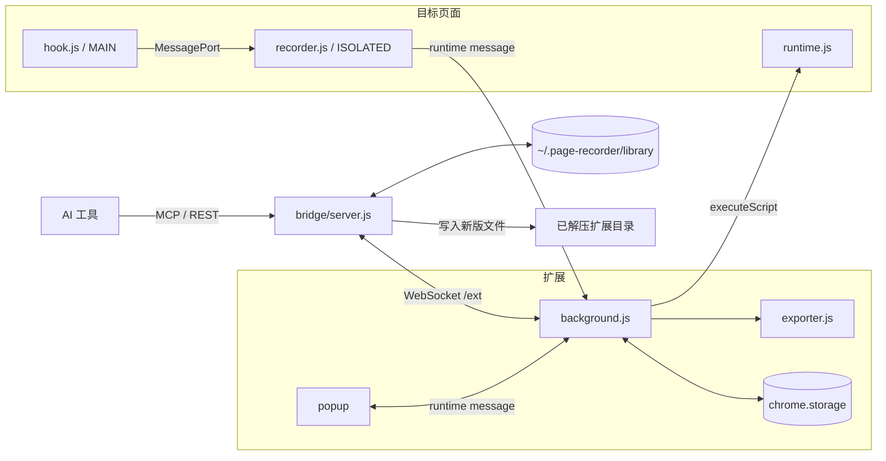

# 系统架构总览

Page Recorder 在用户已登录的 Chrome 里录制页面操作和接口，把录制分析成可回放的脚本和可调用的接口工具，再通过本地桥接交给 AI 工具执行。项目没有运行依赖和构建步骤，扩展直接加载源码，桥接由 `bridge/` 下的三个 Node 模块组成。

## 组件与职责

| 组件 | 运行位置 | 负责什么 | 不负责什么 |
|---|---|---|---|
| `inject/hook.js` | 页面 MAIN world，`document_start`，所有框架 | 包住 fetch、XHR、JSONP、EventSource、WebSocket、sendBeacon，抓请求和响应 | 不持有扩展权限或凭据，只通过 `MessagePort` 传遥测 |
| `content/recorder.js` | ISOLATED world，所有框架 | 记录用户操作、生成元素描述、把控件操作归并成语义步骤、转发请求、显示录制浮层 | 不做接口分析 |
| `background.js` | MV3 service worker | 录制状态、脚本库、消息鉴权、`webRequest` 补抓、标签页与框架选择、真实输入、运行路由、桥接连接、AI 解读 | 不直接操作页面 DOM |
| `lib/exporter.js` | 后台和弹窗共用 | 从事件推导步骤、接口、参数和模板，脱敏，生成脚本、说明、工具 schema | 不执行回放 |
| `lib/runtime.js` | 注入页面，也原样嵌入导出脚本 | 模板展开、请求改写、元素定位、组件驱动、断点续跑、接口直调 | 不决定走直接请求还是页面回放 |
| `popup/` | 扩展弹窗 | 时间线编辑、接口参数、设置、脚本库、导出 | 长任务放在后台，弹窗可随时关闭 |
| `bridge/server.js` | 本机 Node 进程 | 向 AI 工具提供 MCP 和 REST，通过 WebSocket 把调用转给扩展，压缩返回结果，调度备份和自动更新 | 不执行回放，脚本的工作副本在扩展存储里 |
| `bridge/library.js` | 桥接进程内 | 把脚本库同步到 `~/.page-recorder/library/`，重装扩展后恢复 | 不保存 AI 设置，不自动合并其他浏览器资料的脚本 |
| `bridge/updater.js` | 桥接进程内 | 更新已解压扩展目录和已安装的技能 | 不更新开发目录，不覆盖用户手动改过的技能 |

## 四条主要数据流

### 录制

1. `hook.js` 在页面脚本之前装好钩子。还不知道录制状态时先缓冲最多 300 条请求，避免丢掉首屏接口。
2. `recorder.js` 用 `MessageChannel` 和钩子握手，向后台发 `hello` 取得录制状态，再把状态告诉钩子。
3. 操作和请求都以 `event` 消息进入后台。后台校验发送者是否属于当前录制标签页，给 iframe 事件补上框架地址，请求脱敏后入库。
4. 停止录制时写入脚本库，之后由 `PR_EXPORTER.analyze` 按需推导接口和参数。

详见[录制与请求捕获管线](../recording/capture-pipeline.md)和[录制分析、参数关联与产物](../recording/analysis-and-parameters.md)。

### 运行

`runRecording` 决定走直接请求还是页面回放：

- **直接请求**：在匹配的页面里用录制参数和实时鉴权发请求，不操作页面。
- **页面回放**：每次执行段都向 MAIN world 注入一份只负责网络观测和改写的运行时（`networkOnly`），再在 ISOLATED world 执行操作。这样回放令牌和真实输入通道不暴露给页面脚本。

后台每秒探测注入的文档是否还在。页面跳转时 Chrome 可能让 `executeScript` 一直挂起，探测到文档变化就返回 `navigated`，下一轮从断点继续。

详见[运行路由、直接请求与校准](../replay/execution-routing.md)和[页面回放运行时](../replay/runtime-engine.md)。

### AI 调用

AI 工具通过 MCP stdio、MCP HTTP 或 REST 调用桥接。桥接把 `list`、`get`、`run`、`call` 等方法经 WebSocket 发给扩展，`bridgeHandle` 执行后按请求 id 返回。扩展每 30 秒由 `chrome.alarms` 检查一次连接，所以桥接启动后扩展最多约 30 秒连上。桥接未运行时，浏览器控制台出现 `ERR_CONNECTION_REFUSED` 属于这个重连循环的正常现象。

详见[桥接服务生命周期与连接](../bridge/server-lifecycle.md)和 [MCP 工具与结果处理](../bridge/mcp-tools-and-results.md)。

### 备份与自动更新

扩展在 `hello` 里用 `capabilities` 声明自己支持 `librarySync` 和 `selfUpdate`，旧版扩展不声明，桥接就不向它发这些新方法。

- **备份**：连接登记后，或扩展发出 `libraryChanged` 时，桥接比较两边的 `savedAt`，把较新的脚本分段取回本机目录。每个浏览器资料一个子目录，互不覆盖。
- **自动更新**：桥接发现连接的扩展版本较旧时，先确认扩展空闲，再写入新文件并让扩展重新加载。已安装的技能也随桥接版本更新。

详见[脚本库本机备份与恢复](../bridge/library-backup.md)和[扩展与技能自动更新](../operations/auto-update.md)。

## 关键架构约束

- **脚本的工作副本在扩展里。** 没开桥接时也能录制和运行。桥接在 `~/.page-recorder/library/` 保存一份备份，用于重装扩展后恢复，桥接重启不影响已保存的录制。
- **MAIN world 不可信。** 页面脚本和钩子共享环境，所以回放令牌、真实输入和后台消息都留在 ISOLATED world。安全边界见[凭据处理与信任边界](../security/credentials-and-trust.md)。
- **`runtime.js` 有两种使用方式。** 它既被扩展注入，也被原样嵌入导出的控制台脚本，修改时不能依赖扩展 API，扩展专属能力要通过 `hooks` 传入。
- **录制端和回放端共用定位算法。** `recorder.js` 和 `runtime.js` 各有一份元素上下文算法，改其中一份要同步另一份。
