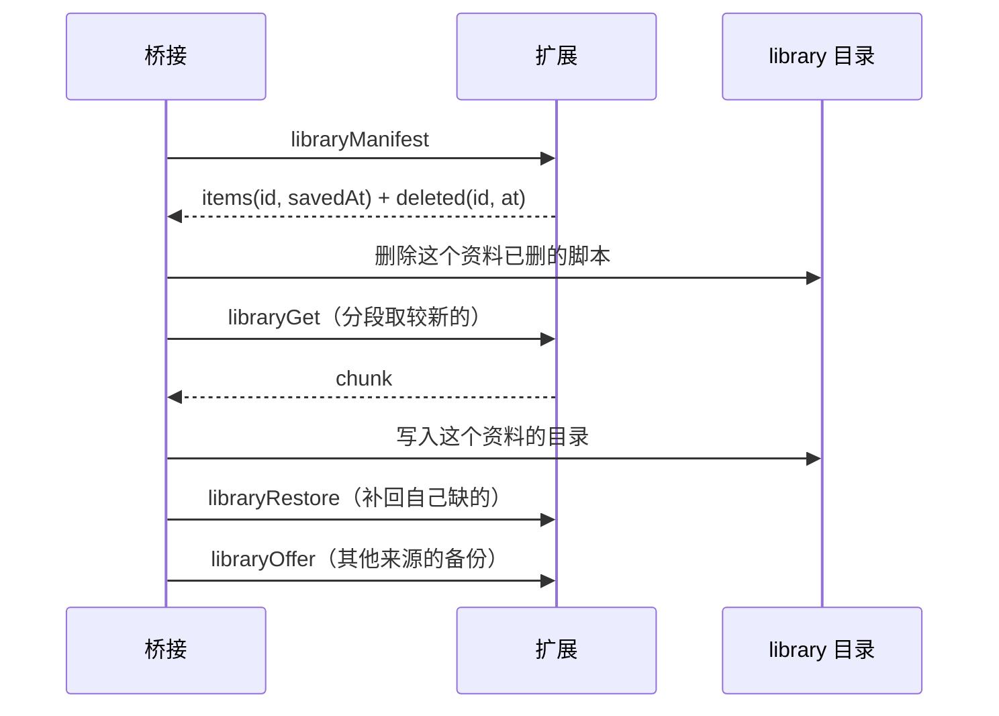

# 脚本库本机备份与恢复

扩展的 `chrome.storage` 跟着扩展 ID 走，卸载或换目录加载后就没了。所以桥接在 `~/.page-recorder/library/` 保存一份副本，这个目录不在扩展文件夹和 npm 缓存里，升级不会碰到。

扩展里的仍是工作副本，没开桥接时也能录制和运行。录完还没连过桥接的脚本只存在扩展里。

代码在 `bridge/library.js`，调度在 `bridge/server.js`，扩展侧的方法在 `background.js` 的 `bridgeHandle`。状态目录可以用 `PR_BRIDGE_DIR` 改，测试就是这样隔离的。

## 文件格式

```text
~/.page-recorder/library/
  .index.json
  <instanceId 的哈希>/<脚本 id>.json
```

每个浏览器资料一个子目录，所以两个资料里 `id` 相同的脚本互不覆盖。目录名用 `instanceId` 的 SHA-256 前 32 位，扩展发来的值不直接当路径。

| 文件 | 内容 |
|---|---|
| `<id>.json` | `{ format: "page-recorder-library-item", version: 1, owner, savedAt, restoredFrom?, dismissed?, item }` |
| `.index.json` | 加速用的索引，记录 `savedAt`、归属、名称、来源和文件修改时间 |

- 目录按 `0700` 创建，文件以 `0600` 权限原子写入：先写临时文件，再重命名。
- **脚本文件才是准的。** 索引丢了或文件修改时间变了，就重新读那个文件。格式不对、内部 `id` 或归属和路径对不上的文件会被忽略。
- `id` 只允许字母、数字、`_`、`-`，最长 128 位。

`owner` 记录 `instanceId`、资料名和扩展 ID。`instanceId` 是扩展首次连接时生成并存在扩展存储里的，所以**卸载重装后是新实例**。

## 写入前的清理

备份从扩展发出时走了三层处理：

1. `scrubBackup` 清掉密码框的值。同样的值如果出现在请求、接口覆盖值、AI 说明或步骤效果里，换成 `__PR_SECRET_<id>__` 占位符，回放时由密码参数填回。这一步不看录制时的 `maskPasswords` 开关。识别依据是步骤的 `sensitive`、`secretInput`，以及 `type=password` 或常见的密码字段名。
2. `packageOf` 按**默认脱敏设置**处理。地址里的令牌和签名、请求头、响应里的敏感字段都不保留。
3. `library.write` 去掉 `settings`，因为里面有 AI API Key。

所以备份和录制包一样不是无损的。起始地址带 `token`、`sign` 这类参数的脚本，恢复后地址里是打码的值，可能要重新录制。关了密码脱敏录的脚本，恢复后要重新填写密码。

## 同步流程



**触发时机**：扩展连接登记后，以及扩展发出 `libraryChanged` 时，桥接防抖 300ms 后同步。同一连接同一时间只跑一次，期间又有变化就再跑一轮。只有声明了 `librarySync` 能力的扩展才会参与。

`syncBrowser` 按这个顺序处理：

1. **删除**：扩展记录的删除项，备份不比删除时间新就删掉这个资料自己的文件。
2. **备份**：扩展里比备份新的脚本分段取回，每段 4M 字符，避开 WebSocket 单条消息上限。
3. **补回**：这个资料的备份里有、扩展里没有、也没被删除的脚本，自动推回扩展。
4. **提示**：把其他实例留下的、这里没有的脚本按来源分组发给扩展，由弹窗询问用户。在线的实例、被隐藏的副本、这里已删除的脚本都不提示。

单条脚本保存或恢复失败只写日志，不影响后面的脚本。

## 删除规则

扩展删除脚本时，把 `id` 和时间写进 `chrome.storage.local` 的 `libDeleted`，最多保留最近 1000 条。这样桥接没开时删的脚本，下次连上也能从备份里删掉。

- 只删这个资料自己的那份，别的资料的备份不动。
- 删除后又重新保存的脚本 `savedAt` 更新，算新脚本。
- 扩展恢复时也会检查 `libDeleted`，删除时间不早于备份的不恢复。
- **用户删掉恢复来的脚本时，来源副本会被隐藏。** 桥接沿 `restoredFrom` 把来源副本标记为 `dismissed`，之后不再提示恢复，文件保留。来源资料重新连上且还有这条脚本时取消隐藏。
- **删除记录只存在扩展里。** 删除还没同步到备份就卸载扩展时，这条记录会随扩展存储一起消失，旧备份之后仍会出现在恢复提示里。

## 恢复流程

不同资料可能是不同店铺的账号，所以其他实例的备份**不会自动并入**，由用户选择：

1. 弹窗在脚本库页显示“本机保存着 N 条脚本”和“恢复到这个浏览器”。
2. 点击后 `libRestoreOffer` 向桥接发 `libraryRestore` 事件，并立即从列表移除这组提示。恢复是异步进行的，弹窗提示“正在恢复”。
3. 桥接只接受最近一次发给这个连接的来源，且这个来源当前不在线。
4. `restoreOwner` 把这组里当前浏览器没有的脚本分段推过去。扩展成功写入的，桥接再**复制一份**到当前资料的目录并记下 `restoredFrom`。来源的备份不动。
5. 扩展判断要跳过的（已删除、已有更新的）不算恢复成功，不产生副本。

扩展把本机文件当外部输入处理：

- `validLibItem` 校验 `id`、`savedAt`、起始地址和每个事件。起始地址只能是 http、https、file，地址不能内嵌账号密码。
- 上传步骤的本机路径被清空。
- 使用本机当前设置。

### 恢复后的权限

备份记录了来源扩展 ID。只有**来源扩展 ID 等于当前扩展、且脚本原本不是导入的**，恢复后才是普通脚本。同目录重装时扩展 ID 不变，所以不受影响。

其他情况（换了目录、来自别的扩展）标记 `imported: true`，按导入的录制包对待：不走页面 SDK，带实时身份的请求不跟随重定向。这个标记也写进新的备份，再次重装不会变回普通脚本。

## 修改时注意

- 给脚本增加字段时，确认它能通过 `validLibItem`，也不含不该长期落盘的内容。
- 改同步顺序时要跑 `test/persistence.test.mjs`，它覆盖了重装恢复、大脚本分段、删除、跨资料隔离、来源校验和单条失败隔离。
- 新增扩展方法时要先判断 `capabilities`，旧版扩展不认识这些方法。

另见[弹窗、脚本库与 AI 解读](../extension/library-and-ai-docs.md)、[扩展与技能自动更新](../operations/auto-update.md)、[凭据处理与信任边界](../security/credentials-and-trust.md)、[桥接服务生命周期与连接](./server-lifecycle.md)。
