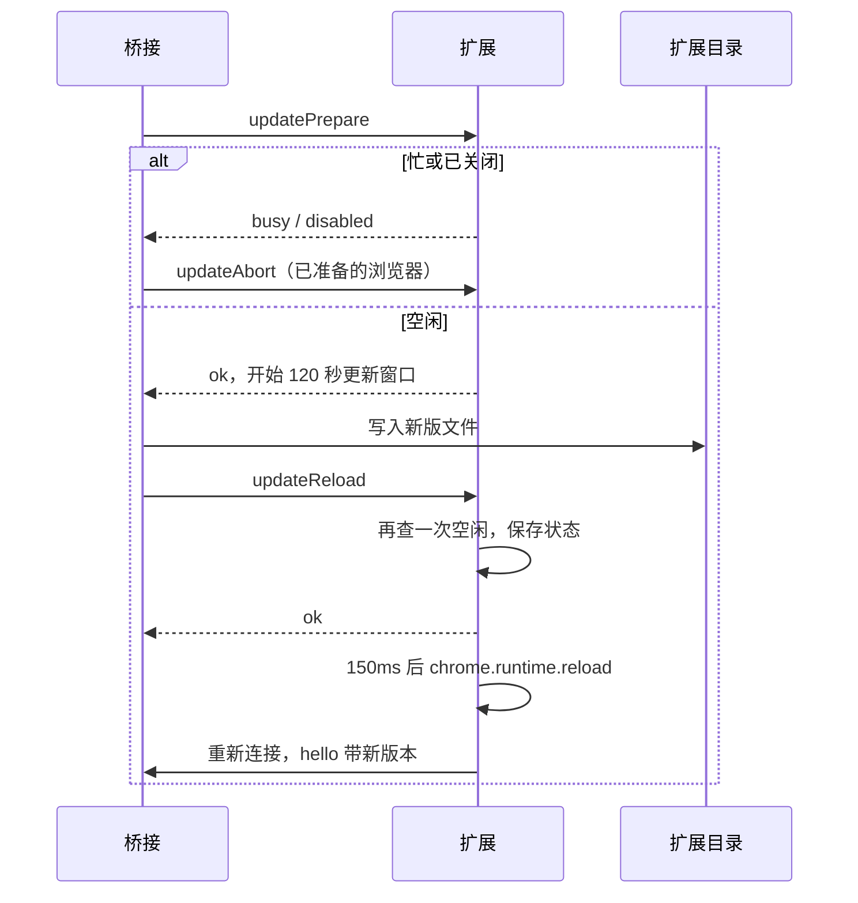

# 扩展与技能自动更新

维护者只发布 npm 包。AI 工具启动新版桥接后，桥接把自己带的扩展文件写进用户已加载的扩展目录，让扩展重新加载，并更新已安装的技能。

代码在 `bridge/updater.js`，调度在 `bridge/server.js` 的 `runAutoUpdate`，扩展侧的门禁在 `background.js`。

## 前提

自动更新只在这些条件都满足时生效：

- **Chrome 的开发者模式开着。** 开发者模式一关，Chrome 就会停用已解压的扩展，需要用户重新打开并在扩展卡片上启用。
- **扩展已经是支持自动更新的版本。** 没有声明 `selfUpdate` 的旧版扩展要手动迁移最后一次：

  ```bash
  npx -y page-recorder-mcp@latest extension <现有扩展目录>
  ```

  然后在扩展卡片上点“重新加载”，重启 AI 工具，并刷新已打开的页面。
- **一直使用同一个扩展目录。** 已解压扩展的 ID 由路径算出，换目录就是另一个扩展。
- **桥接本身是新版。** 端口上还是旧版桥接时不会更新，见[桥接服务生命周期与连接](../bridge/server-lifecycle.md)。

关闭方式有三种：扩展设置里关掉自动更新、启动参数 `--no-auto-update`、环境变量 `PR_AUTO_UPDATE=0`。**只有扩展设置在任何情况下都生效。** 后两种只影响这个进程和它拉起的后台桥接，别的 AI 工具已经起好的后台桥接不受影响。从带 `.git` 的源码目录运行时默认不更新，避免改动开发环境。

## 哪些目录会被更新

桥接只更新同时满足下面条件的目录：

1. 目录由 `extension` 子命令记录过，或者是默认的 `~/page-recorder-extension`。
2. 目录里没有 `.git`，也不是 npm 包根目录。
3. `manifest.json` 的名称以 `Page Recorder` 开头。
4. 由目录路径算出的扩展 ID 和正在连接的扩展一致。路径和真实路径都会计算，以兼容符号链接。

扩展 ID 是路径 SHA-256 的前 16 字节，每半字节映射到 `a-p`。Windows 上路径按 UTF-16LE 编码，盘符转大写。**这条 Windows 规则只有单元测试，没有在真实的 Windows Chrome 上验证过。**

## 更新流程



1. **筛选**：跳过没有 `extensionId` 或 `selfUpdate` 能力、版本不旧、这个版本已经重新加载过的浏览器。同一目录的浏览器分成一组，因为它们共用文件。
2. **准备**：组内每个浏览器都要回复 `ok`。有一个拒绝就让已准备的全部 `updateAbort`。对方忙时 60 秒后重试。
3. **写文件**：目录版本比桥接旧才写。写入失败时还原目录、记日志并取消更新窗口，60 秒后重试。同一进程对一个目录最多试 3 次，之后不再打扰扩展，下次启动桥接再来。
4. **重新加载**：逐个浏览器调用 `updateReload`。只有确实重新加载的实例才写入 `attempts`，没成功的下一轮再试，文件不用重写。

几个 AI 工具可能同时启动，所以写入由 `~/.page-recorder/update.lock` 目录锁保护，超过 60 秒的锁视为过期。

状态保存在 `~/.page-recorder/update.json`：

| 字段 | 内容 |
|---|---|
| `extensionDirs` | `extension` 子命令记录的目录 |
| `attempts` | 每个实例已经重新加载过的目标版本，防止反复重载 |
| `skills` | 每个技能文件当前受管的哈希和版本 |

### 空闲门禁

扩展在这些情况下回复 `busy`：有进行中的回放或接口调用（包括占用标签页前的准备阶段）、正在开始或停止录制、正在录制、AI 解读运行中、有标签页在运行、调用或跳转。

`updatePrepare` 成功后的 120 秒内，`start`、`aiAnalyze`、`run`、`call`、`libRun` 都会报“扩展正在更新，请几秒后重试”。这样不会出现页面注入新代码、后台还是旧代码的情况。`updateReload` 收到时再检查一次，这时变忙就不重新加载。

### 文件写入的边界

写入先在同级临时目录备好完整副本，再逐个文件替换，替换前保存旧文件，`manifest.json` 最后替换。

- **中途失败会全部还原。** 已替换的文件换回旧版，新增的文件删除，版本号仍是旧的。
- 个别文件还原不了时，临时目录保留，旧文件路径写进错误日志。
- 新版已经不用的旧文件不会被删除。

## 打开着的页面

重新加载后旧的内容脚本失效。扩展收到 `onInstalled` 后：

1. 立即重连桥接。
2. 如果原因是 `update`，向所有未休眠的 http、https 标签页的全部框架重新注入 `content/recorder.js`。

`recorder.js` 用版本号作为注入标记，版本相同才跳过，所以新版能接管旧版。新的内容脚本重新和页面里的 `hook.js` 握手，钩子关闭旧端口，换到新端口。

**重新注入不包括 `hook.js` 和 `file://` 页面。** 已打开的页面继续运行原来的钩子，改了钩子的版本要刷新页面才完全生效。`file://` 页面也要手动刷新。1.5.0 及更早版本的钩子握手一次后就移除监听，这些页面要刷新后才能恢复钩子的请求捕获。

## 技能

桥接只更新已经安装的技能文件：

- `~/.workbuddy/skills/page-recorder/SKILL.md`
- `~/.claude/skills/page-recorder/SKILL.md`

| 情况 | 处理 |
|---|---|
| 文件不存在 | 不安装 |
| 文件是符号链接 | 不动，视为用户自己管理 |
| 内容已经是新版 | 只记录哈希和版本 |
| 第一次接管（包括用户改过的文件） | 先备份到 `~/.page-recorder/skill-backups/`，再写入 |
| 接管后用户改过 | 不覆盖，写日志 |
| 其他工具已装了更高版本 | 不降级 |

单个技能更新失败不影响其他技能和扩展更新。

## 排查

先看状态和日志：

```bash
curl http://127.0.0.1:17321/api/status
tail ~/.page-recorder/bridge-17321.log
```

| 现象 | 可能原因 | 处理 |
|---|---|---|
| `capabilities` 为空或字段不存在 | 扩展是旧版，或端口上是旧版桥接 | 手动迁移一次，或重启桥接 |
| 扩展变成停用 | 开发者模式被关了 | 打开开发者模式，在扩展卡片上启用 |
| 日志连续出现“更新扩展目录失败” | 目录不可写或文件被占用 | 解决后重启 AI 工具。试满 3 次后这个进程不再重试 |
| 版本一直不变，日志没有更新记录 | 目录不符合条件，或扩展 ID 对不上 | 检查是否用 `extension` 子命令生成，是否换过目录 |
| `attempts` 已有该版本但扩展还是旧的 | 重新加载没有读到新文件 | 手动重新加载。同一版本不会自动再试 |
| 录制后接口响应缺失 | 页面还在用旧钩子 | 刷新页面 |
| 技能没更新，日志提示手动改过 | 用户编辑过技能 | 合并改动，或删除后重新安装 |

## 修改时注意

- 新增扩展运行需要的顶层文件时，更新 `EXTENSION_FILES` 和 `package.json` 的 `files`。
- 发布时必须同时提高 `package.json` 和 `manifest.json` 的版本，否则扩展不会被判定为旧版，见[测试、CI 与发布](./testing-and-release.md)。
- 新增后台长任务时，要把它纳入 `updateBusy`，否则可能被重新加载打断。
- 改更新逻辑后运行 `test/persistence.test.mjs`。它用假扩展验证流程，**不证明真实 Chrome 的重新加载行为**，还要在真实 Chrome 上验证。

另见[脚本库本机备份与恢复](../bridge/library-backup.md)、[凭据处理与信任边界](../security/credentials-and-trust.md)。
