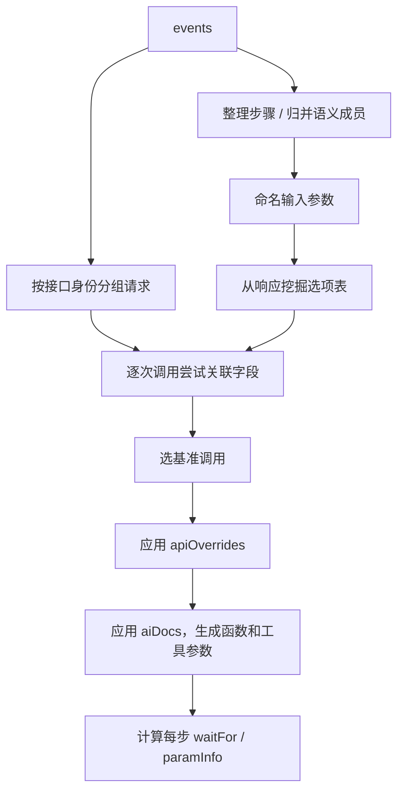

# 录制分析、参数关联与产物

`lib/exporter.js` 导出 `PR_EXPORTER`，在后台、弹窗和 Node 测试中都能运行。分析是**纯函数式重算**：入库的是原始事件，每次读取都由 `analyze(events, settings, state, apiOverrides, aiDocs)` 重新推导接口和参数。修改分析规则会直接影响已保存的脚本。

## 输出产物

`build()` 先调用 `analyze()`，再生成：

| 产物 | 用途 |
|---|---|
| `analysis` | 步骤、接口、参数的完整分析结果 |
| `bundle` | 扩展回放和直接请求使用的数据 |
| `script` | 可在控制台执行的 JS，内嵌 `lib/runtime.js` |
| `raw` | 导出 JSON |
| `summary` | Markdown 说明 |
| `tools` | 每个接口的 JSON Schema |
| `prompt` | AI 解读提示词 |

`recordingData(A, outward)` 区分两种视图。`outward = true` 用于给人、给 AI 和导出脚本，会额外遮盖非标准请求头里像令牌的值。扩展内部回放用 `outward = false`，只按名字遮盖，实时请求头在调用时补上。

## 分析流程



## 接口身份

同一个接口的多次调用按下面的键合并：

```text
方法 + 主机 + 路径模板 + 路由参数 + 请求体操作
```

- **路径模板**：纯数字、UUID、长 hex 和含数字的长串分别变成 `{id}`、`{uuid}`、`{key}`。
- **路由参数**：`mod`、`action`、`method`、`route` 等查询参数算进身份，所以 `index.php?mod=a` 和 `mod=b` 是两个接口。
- **请求体操作**：GraphQL 的 `operationName`、JSON-RPC 的 `method`、`action` / `cmd`、mtop 的 `data.url` 都能区分网关式接口，包括套在 JSON 字符串里的情况。

这个规则要和运行时的 `opOf`、`findApi` 保持一致，否则回放时匹配不到录制的接口。

## 输入参数

输入框、下拉框、上传、单选和复选框都可以成为参数。参数名优先取表单项标签，同一个框录了多次时，最后一次用主名字，较早的加 `_第N次`，并记录 `overwrittenBy`。

**参数名是兼容性契约。** 已保存的脚本和 AI 调用都按名字传参，所以命名分两轮：

1. 早就支持的类型（输入、上传、单选下拉）按历史规则先命名。
2. 后加的类型（单选框、复选框、原生多选）再命名，且不能占用第一轮的名字。

第一轮的计数器故意保留普通对象语义，连 `constructor` 这类名字的历史结果都不变；第二轮才用无原型对象。`test/params.test.mjs` 专门保护这些规则，改命名逻辑前先看这个文件。

## 字段关联

`linkOne` 尝试把请求字段换成 `{{参数}}` 模板，匹配顺序如下：

| 情况 | 模板示例 |
|---|---|
| 密码占位符 | `{{密码}}` |
| 日期，含格式换算 | `{{开始日期\|date:YYYY-MM-DD}}`、`{{开始日期\|ts:ms}}`、`{{开始日期\|iso:start}}` |
| 值相等 | `{{关键词}}`，数字字段为 `{{最低价\|num}}` |
| 选项文字到编码 | `{{仓库\|opt}}` |
| JSON 字符串内部的值 | `{{商品标题\|jsonesc:2}}` |

为了减少误关联，分析器有这些保护：

- **歧义不关联**：两个输入框录到同一个值时，无法判断字段属于哪个参数。
- **时间顺序**：字段只能关联在这次调用之前已经填完的参数。
- **撞值排除**：参数开始填之前页面就发过同样的值（比如默认 `pageSize=100`），不算关联。
- **短数字谨慎**：一两位数字只有下拉框 `name` 和字段名对得上才关联。

### 基准调用

一个接口被调用多次时，参数取**能关联上最多输入参数的那次**，并列取最早的。被后续输入覆盖的参数只算半分，所以并列时倾向于关联最终值的调用。都关联不上时，取输入参数都填完之后的第一次调用，而不是页面刚打开时带默认值的调用。

### 选项表挖掘

自定义下拉显示文字，接口却发编码。`mineOptions` 在录到的响应里找这样的数组：同时包含录制时选的文字，以及选完之后请求里真实发过的编码。编码列和文字列都不能有重复；多处结果不一致时优先 `value`、`id`、`code` 这类键名，仍不一致就放弃。

## 回放和调用所需的元数据

- `apiOverrides` 在关联之后应用。值为 `{ __deleted: true }` 表示从请求中移除字段。
- `replayable` 为假的接口不能直接重发：请求体被截断、二进制、含文件的 multipart、EventSource、WebSocket。
- `okSignals` 记录成功响应的业务码，`okShape` 记录响应形态，直接请求时用它们判断成败。
- `optionalOnly` 标记只由可选步骤触发的接口，直接请求时不调用。
- `waitFor` 记录每步要等的接口：选完值后 5 秒内、同一框架、由 fetch 或 XHR 发出，最多 5 个。JSONP、Worker、表单提交和其他标签页的请求回放引擎等不到，不进入这个列表。

## 工具 schema

`applyDocs` 为每个接口生成函数名和 `toolArgs`。`path`、`query`、`body` 字段摊平成一组参数，重名时加前缀或序号。

值本身是 JSON 字符串的字段（如 mtop 的 `data`）会继续展开成 `data.jsonBody.pagination.current` 这样的参数，最多递归 3 层、每个字段最多 40 个。调用时只改给出的里层字段，其余保持录制值。

## 修改时注意

- 单选的选择规则（文字唯一、值唯一、`#序号`）在 `exporter.js`、`background.js`、`runtime.js` 三处实现，必须保持一致。
- 接口身份规则改动后，已保存录制的接口名可能变化，`aiDocs` 和 `apiOverrides` 都按接口名存储，会因此失联。
- 导出脚本用 `__pageRecorderRuntime.toString()` 内嵌运行时，运行时不能依赖模块外的变量。
- 模板文本要防注入和 ReDoS，相关回归测试在 `test/security-and-bugs.test.mjs`。

另见[录制与请求捕获管线](./capture-pipeline.md)、[运行路由、直接请求与校准](../replay/execution-routing.md)、[弹窗、脚本库与 AI 解读](../extension/library-and-ai-docs.md)。
