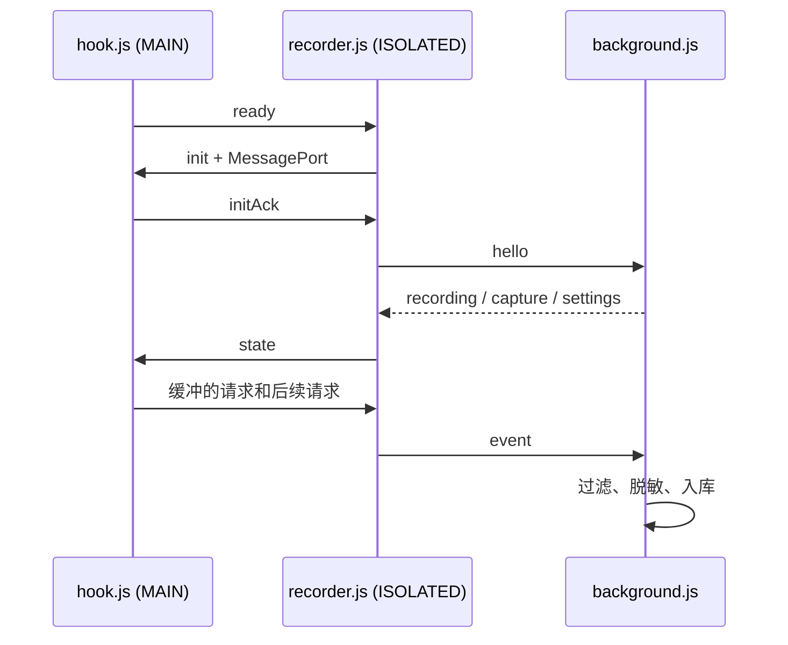

# 录制与请求捕获管线

录制由三层协作：`inject/hook.js` 在页面主环境抓请求，`content/recorder.js` 在隔离环境记录操作，`background.js` 校验、补抓、脱敏并保存。

## 状态握手

钩子必须在页面脚本之前运行，这时还不知道当前页面是否在录制。它有三种状态：

| `state` | 含义 | 行为 |
|---|---|---|
| `null` | 未知 | 请求进缓冲区，最多 300 条 |
| `true` | 录制或回放抓包中 | 发送缓冲和新请求 |
| `false` | 未录制 | 丢弃缓冲，直接放行，不观察 DOM |

两个脚本的注入顺序不固定，所以双方都会宣告自己：钩子发 `ready`，内容脚本发 `helloHook`。内容脚本收到 `ready` 后创建 `MessageChannel`，把一个端口转给钩子，此后遥测只走私有端口。消息要求 `isTrusted` 且来自当前窗口。

10 秒内没有内容脚本接管时（例如极端沙箱帧），钩子把状态置为 `false` 并释放缓冲。

### 扩展更新后的重新握手

扩展重新加载后，页面里的旧内容脚本失效，后台会重新注入 `content/recorder.js`：

- 内容脚本用扩展版本号作为 `__PAGE_RECORDER_CONTENT__` 标记，版本相同才跳过，版本不同就由新脚本接管。
- 钩子握手后继续监听，收到新的 `init` 时关闭旧端口并换到新端口。
- 钩子本身不会重新注入，改了 `hook.js` 的版本要刷新页面才生效。

完整流程见[扩展与技能自动更新](../operations/auto-update.md)。

## 请求捕获

### 页面钩子

| 类型 | 捕获方式 | 响应内容 |
|---|---|---|
| fetch | 包住 `fetch`，读响应 `clone()` | 文本类有，超限截断 |
| XHR | 包住 `open`、`setRequestHeader`、`send` | 按 `responseType` 读取 |
| JSONP | `MutationObserver` 发现带回调参数的脚本，临时包住回调 | 回调参数 |
| EventSource / WebSocket | `Proxy` 只拦构造函数 | 开头最多 20 条，标记为截断 |
| sendBeacon | 包住原型方法 | 无 |

几个容易踩的边界：

- 响应通过克隆流读取，超过 `maxBody`、普通请求超过 30 秒、SSE 超过 5 秒就截断，不影响页面自己读取。
- JSONP 包装结束后会还原页面的回调属性。页面自己定义的存取器、只读或继承属性不改写，这时只记请求。
- 对象类型按 `Object.prototype.toString` 判断，因为空白 iframe 里的对象来自另一个 realm，`instanceof` 不可靠。
- 空白 iframe（`about:blank`、`srcdoc`）有独立的 `fetch` 和 XHR，它们由最近的有地址的外层页面接管，请求算在外层页面上。

### webRequest 补抓

钩子看不到 Worker 请求、表单提交、下载，也看不到在钩子安装前就保存了原始 `fetch` 的代码。录制期间后台用 `webRequest` 监听录制标签页及其子标签页，补记地址、方法、请求头、请求体、状态和响应头，但**没有响应内容**（`noBody: true`）。

补抓的过滤规则：

- 脚本请求只保留带 JSONP 回调参数的。
- GET 的页面导航不算接口（它们是步骤），非 GET 的表单提交和下载才记录。
- CORS 预检不记录。

### 去重

同一个请求可能被两边都看到，以钩子记录为准：

- 补抓记录先等 2.5 秒，再按“方法 + 去掉 hash 的 URL + 时间差小于 5 秒”查找钩子记录。比较前先按入库规则脱敏，否则带签名的地址永远对不上。
- 钩子记录后到时，会顶掉已入库的 `via: 'browser'` 记录。
- `pairedIds` 确保一条记录只配对一次，同地址的下一次请求不会被误吞。

## 操作录制

普通操作直接映射成步骤：点击、双击、右键、输入、选择、勾选、按键、滚动、拖动、上传、地址变化。

- **输入合并**：连续键入在 1.5 秒静止、切换字段或下一次操作时合并成一步。
- **按键过滤**：Enter、Esc、Tab 始终记录；普通打字由输入事件记录；输入框里的复制、粘贴、全选、撤销不记录；输入法组字时忽略。
- **滚动过滤**：只录用户滚动（滚轮、触摸、键盘、拖滚动条），页面自动滚动不录。
- **Alt+点击** 提取元素，**Alt+Shift+点击** 提取所在表格或列表。此时阻止页面收到这次点击。

### 语义步骤

日期、下拉、联想框常由脚本改值，没有键盘输入。录制器不针对具体组件库，而是观察**用户动作前后字段值的变化**：

1. 每次按下鼠标或按键时扫描所有字段，并在之后 0、150、600、1500ms 再扫描。
2. 点击字段或小型控件外壳时开启“选择器会话”，用 `MutationObserver` 记录新出现的弹层。
3. 会话中字段值变化时，生成 `fill`、`select` 或 `check` 语义步骤，`pick` 区分 `date` 和 `choice`。
4. 面板里的原始点击成为语义步骤的 `members`，在后台标记 `groupedIn`，时间线上默认折叠。

需要特别区分的情况：

- 键入后页面只是格式化（`1000` 变 `1,000.00`），并回键入那一步。
- 键入回车后被清空（扫码框、聊天框），保留键入和回车，不算选值。
- 其他字段联动回填，只记为这一步的 `effects`，不成为输入参数。
- Chosen 这类按下鼠标就选中的组件，随后补来的 `click` 并入选择步骤，不再多录一步旧选项的点击。

### 点击状态

点击后 350ms 检查目标及上三层的 `aria-expanded`、展开类名和可见内容，以及开关、按下态。结果写入步骤的 `toggle` 和 `state`，回放时已经是目标状态就不再点击。

## 入库

`ingestRequest` 依次执行：

1. `keepRequest` 过滤非 HTTP、埋点、用户排除规则和静态资源。
2. `scrubRequest` 脱敏。是否“已脱敏”只由后台传入的参数决定，**不读事件对象上的字段**，因为事件来自页面，可以伪造。
3. 写入 `events`。

后台只接受当前录制标签页的事件。录制标签页打开的子标签页只收请求，回放中的标签页不会污染当前录制。

密码类输入框的步骤带 `secretInput` 标记。关闭 `maskPasswords` 时值照常留在录制里，写长期备份时靠这个标记清掉，联动效果 `effects` 也不记录这类字段的值。

## 录制生命周期

- **开始**：扩展正在自动更新时拒绝开始。校验 http、https 或 file 页面，新建或续录状态，挂上 `webRequest`，通知标签页。扩展安装前打开的页面没有内容脚本，后台会手动注入，但已发生的首屏请求抓不到。
- **保活**：录制期间每 20 秒调用一次扩展 API，防止 service worker 被回收。后台被事件唤醒时也会同步挂上监听，读完状态发现没在录制再摘掉，避免丢失唤醒它的那条请求。
- **停止**：等 350ms 让钩子记录到达，冲刷补抓队列，移除监听，清除内存中的密码，然后写入脚本库。

`recGen` 用来防止“停止”和“重新开始”的竞态，旧的停止流程发现代际变化后会中止。开始录制走 `trackOp`，停止流程由 `stopInFlight` 标记，两段都算忙，自动更新不会在这期间重新加载扩展。

密码和令牌的完整处理见[凭据处理与信任边界](../security/credentials-and-trust.md)，事件之后如何分析见[录制分析、参数关联与产物](./analysis-and-parameters.md)。
