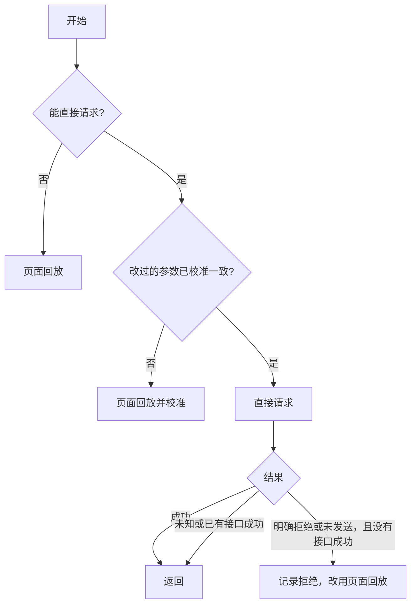

# 运行路由、直接请求与校准

运行入口有两个，都在 `background.js`：

- `runRecording(item, opts)`：运行一条录制，决定直接请求还是回放页面。
- `callApi(item, api, args, opts)`：直接调用某一个接口。

## 运行模式

| `mode` | 行为 | 不能满足条件时 |
|---|---|---|
| `ui` | 回放页面操作 | 按回放结果返回 |
| `api` | 只直接请求关联了输入参数的接口 | 返回 `notSent`，不操作页面 |
| `auto`（默认） | 满足条件时直接请求，否则回放 | 回放页面，`route` 说明原因 |

运行前的校验：

- 参数名不在录制里时直接报错，并列出可用参数。
- 多选参数必须是数组。字符串只按 JSON 数组解析，不按逗号拆分，因为选项文字里可能有逗号。

### auto 的决策

下面任一情况都不能直接请求：

- 没有关联输入参数且可重放的接口。
- 改过的参数没有关联到接口字段。
- 关联接口的请求体不能重发。
- 录制里有提取页面内容的步骤。
- 选择参数的值不在录到的选项表里，换不出编码。
- 校准结果为 `mismatch`。
- `auto` 模式下，这条录制 24 小时内被服务端拒绝过（录制保存后失效）。

**回退只在确定没有副作用时发生。** 已有接口成功、或结果未知（超时、5xx、网络错误）时不回退到页面回放，避免把已经生效的提交再做一遍。直接请求遇到第一个失败的接口就停止，后面的接口不再发送。

`canFallback` 决定被拒绝后能不能回退：

- 请求没发出，或返回 401、403：可以。
- GET、HEAD 接口被明确拒绝（业务码不同或其他 4xx）：可以。
- 写接口返回业务错误或其他 4xx：**不回退**。结果带 `writeRejected: true` 和提示，由调用方先确认有没有生效。这种情况也不记入“24 小时内被拒绝”。

## 失败状态语义

调用方（包括 AI）必须按这些字段决定下一步：

| 字段 | 含义 | 可以重试吗 |
|---|---|---|
| `notSent: true` | 请求根本没发出，通常同时有 `rejected: true` | 可以，改走页面回放或补参数 |
| `rejected: true` | 服务端明确拒绝：4xx（408、429 除外）或业务码和录制时不同 | 查询类接口可以，常见原因是要现算签名。提交类接口除 401、403 外先确认没生效 |
| `writeRejected: true` | `run_recording` 的写接口返回失败，没有自动回放 | 先确认有没有生效，再用 `mode: "ui"` 重试 |
| `unknown: true` | 没拿到完整结果，**服务端可能已经处理** | 提交类接口先确认状态，不要盲目重发 |
| `omittedHeaders` | 录制时脱敏的头这次补不上，请求照发 | 401 时优先看这里 |
| `liveHeaders` | 这次使用了页面最新值的请求头 | 仅说明 |

会判为 `unknown` 的情况包括：网络错误、超时、跨域被拦、响应没读完、被重定向到其他路径（多半是登录页）、响应结构和录制时完全对不上。

成功判断不只看 HTTP 状态：HTTP 200 但业务码和录制时的 `okSignals` 不同，也算 `rejected`。

## 直接请求

### 页面选择

`callApi` 在**发出这个接口的页面**里调用，这样带着该页面的 Cookie 和登录态。优先级：

1. 扩展之前为这个源打开的标签页。
2. 其他开着的同源页面，或同站页面里的同源 iframe。
3. 都没有时新开一个并留着复用。

普通接口在 ISOLATED world 调用。mtop 网关（`/h5/<接口>/<版本>/`）在 MAIN world 调用，由页面的 `lib.mtop` 现算签名，这时不传扩展缓存的鉴权信息。导入的录制包不使用这条路径。

### 实时鉴权

录制时敏感头被存成 `***`。直接请求时，后台用 `webRequest` 记下的最新值补上：

- 缓存键是 `[tabId, documentId, scope]`，只给同一文档使用，5 分钟过期，最多 256 条。
- `scope` 是目标接口的 `origin + path`。`Authorization`、CSRF 这类可共享的头还会额外记一份 `origin` 级别。签名类头只认同一路径。
- 只补录制时这个接口**本来就带**的头。
- 跨源接口可以使用后台按目标接口记下的值。页面上的隐藏输入框和 CSRF meta **只给同源接口**。
- 脱敏的查询或请求体字段拿不到新值时不发送（`notSent`）。脱敏的请求头拿不到时照发，并列在 `omittedHeaders`。
- 带实时鉴权或脱敏字段的请求使用 `redirect: 'error'`，避免凭据跟随重定向到别的地址。

### 参数合并

`mergeApiParams` 合并录制参数和调用传入的 `api_params`，并跳过 `__proto__`、`constructor`、`prototype`。调用参数支持扁平工具参数，也支持 `{ path, query, body }`。

## 校准

参数第一次改动时，`auto` 走页面回放，同时比较**页面自己发出的值**和**模板算出来的值**：

| 结果 | 含义 |
|---|---|
| `ok` | 一致，以后可以直接请求 |
| `mismatch` | 不一致，或未关联字段也跟着变了，一直走页面回放 |
| `unknown` | 没看到或页面没改这个值，不下结论 |

只有回放全部成功才采纳校准结果。结论按录制的 `savedAt` 和 `paramSig` 绑定，录制被修改、或参数名换了对应的步骤和字段时自动作废。时间戳、签名这类每次都变的字段不参与比较。

## 页面回放的调度

- **分段**：连续同一框架的步骤组成一段，依次在顶层或对应 iframe 里执行。
- **iframe 匹配**：源、路径、hash 路由和路由参数必须一致，其余参数用于在多个候选中选最像的，优先显示中的 iframe。录制在 iframe 的步骤不会落到顶层页面。
- **跳转续跑**：每段最多 20 轮。页面跳转后读取最新断点继续；最后一步引起跳转时直接算完成。
- **并发**：回放独占标签页（`runningTabs`），接口调用可以并发（`callingTabs`），回放会等调用结束。
- **标签页复用**：默认复用扩展开过的同站标签页，并设置 `autoDiscardable: false`。浏览器启动时清除记录，因为标签页编号会重新分配。
- **全量抓包**：回放期间收集标签页所有框架的请求放入 `network`，最多 300 条、8MB。结束前等 1 秒无新请求，最多等 5 秒。
- **超时**：通知页面取消回放，避免用户重试时出现两份操作，并在结果里说明已完成到第几步。

回放内部如何定位和操作元素见[页面回放运行时](./runtime-engine.md)。凭据范围见[凭据处理与信任边界](../security/credentials-and-trust.md)。MCP 层如何包装这些结果见 [MCP 工具与结果处理](../bridge/mcp-tools-and-results.md)。
